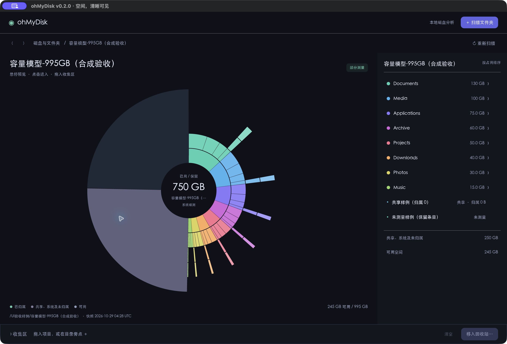

# ohMyDisk

[](https://github.com/looading/ohMyDisk/actions/workflows/ci.yml)

ohMyDisk 使用 Rust 和 iced 分析本地磁盘空间，提供旭日图、按大小排列的文件列表与明确的清理计划。GUI 和 MCP 共用按需启动的本地服务，Codex 等 agent 可以在 GUI 未打开时使用扫描与清理能力。

## 下载

版本发布后，可从 [GitHub Releases](https://github.com/looading/ohMyDisk/releases) 下载对应平台的 ZIP。每份 ZIP 都提供同名 `.sha256` 校验文件，并包含使用说明和 MCP 接入文档。

| 平台 | 产物 |
|---|---|
| Windows x64 | [ohMyDisk-windows-x86_64.zip](https://github.com/looading/ohMyDisk/releases/latest/download/ohMyDisk-windows-x86_64.zip) |
| macOS Apple Silicon | [ohMyDisk-macos-aarch64.zip](https://github.com/looading/ohMyDisk/releases/latest/download/ohMyDisk-macos-aarch64.zip) |
| macOS Intel | [ohMyDisk-macos-x86_64.zip](https://github.com/looading/ohMyDisk/releases/latest/download/ohMyDisk-macos-x86_64.zip) |

普通分支构建也可以从 [Actions](https://github.com/looading/ohMyDisk/actions) 对应运行的 Artifacts 下载。macOS 解压后打开包内的 `ohMyDisk.app`，Windows 运行 `ohmydisk.exe`。

## 运行

要求 Rust 1.88 或更高版本。当前使用 iced 0.14 与 rmcp 3.8。

```sh
cargo run -p ohmydisk --release
```

命令行入口默认打开 GUI，也可以运行本地 MCP 或执行诊断请求。

```sh
cargo run -p ohmydisk --release -- mcp --stdio
cargo run -p ohmydisk --release -- call get_capabilities
```

默认状态保存在当前用户的本地应用数据目录内。`--data-dir` 或 `OHMYDISK_DATA_DIR` 可以指定独立状态目录，适合测试。

## 功能

- 本地磁盘与文件夹扫描，包含隐藏文件，记录权限错误和未遍历的边界。
- 默认按系统容量展示占用，旭日图与目录列表联动，支持悬停预览、目录下钻和路径导航。
- 融合式窗口顶栏：macOS 保留原生红黄绿，Windows 提供自绘窗口按钮、顶栏拖动与边缘缩放；窄窗可切换图表和目录列表。
- 待清理集合、不可变计划、默认移入回收站和独立的永久删除。
- 后台作业进度与取消，冻结扫描快照与稳定分页查询。
- 本地 stdio MCP，完整的扫描、查询、制订计划和清理流程。

默认不跟随符号链接、junction 和未知 reparse point，不自动提权。无法完整扫描的目录不能作为完整目录清理。移入回收站不表示容量已经释放。

默认占用图以系统报告的文件系统容量为边界，将原始可用空间、已确认文件占用，以及“共享、系统及未归属”空间放在同一张图中。逻辑大小保留在详情和 API 中；即使稀疏文件或共享区块使逻辑总量超过容量，也不会把这个总量当作磁盘占用。程序不截断原始文件大小，也不按比例分摊未知空间。

macOS 使用系统返回的文件 private size；Windows 对本地、无共享簇能力的 NTFS 使用普通单链接文件的分配大小。硬链接、未测量的文件和无法枚举的子树都保留明确状态，ReFS、网络卷及未知文件系统不会冒充已经测量。已确认的文件占用不等于清理后必然释放的容量；权限不足、共享区块和范围外文件等仍可能留在未归属区域。旧快照可继续查询逻辑大小，查看占用树需要重新扫描。详细字段和查询规则见 [MCP 大小统计](docs/mcp.md#大小统计与容量对应)。



图中使用合成验收数据：995 GB 总容量、245 GB 可用、500 GB 已确认文件占用及 250 GB 共享、系统及未归属空间。

GUI 执行清理时显示应用内确认。MCP 信任客户端完成人工确认：必须先展示计划，再批准对应的回收站或永久删除工具；应用不再增加第二次弹窗。永久删除不可恢复。

窗口最小尺寸为 500×480 逻辑像素，小于 1000 像素宽时折叠右侧预览。确认弹窗的标题和操作区固定，中间内容可滚动。Windows 的自绘最大化按钮暂未接入 Windows 11 悬停 Snap Layout 菜单；普通窗口拖动、缩放和最大化调用系统能力。关闭 GUI 后，已经受理的后台作业按原生命周期继续执行。

## Codex 与其他 MCP 客户端

先构建可执行文件，再将其绝对路径加入客户端。详见 [MCP 接入](docs/mcp.md)。配置示例：

```toml
[mcp_servers.omd]
command = "/absolute/path/to/ohmydisk"
args = ["mcp", "--stdio"]
```

Windows 使用 `ohmydisk.exe` 的实际绝对路径。两个执行工具需要各自在宿主中启用人工审批，不能将整个服务设为无条件批准。

部分 Windows 宿主禁止子进程脱离 Job Object。遇到后台服务启动的 `Access is denied` 时，在独立终端运行 `ohmydisk.exe service --stay-alive` 并保持终端开启，再连接 MCP。该模式也用于托管 CI 的临时服务监督，详见 [受限宿主接入](docs/mcp.md#受限-windows-宿主)。

## 扫描性能

扫描使用 Tokio 协调有限数量的目录 worker，阻塞的文件系统调用在 blocking pool 中执行，同一服务内的扫描共用文件系统并发预算。macOS 复用批量目录元数据，其他平台保留通用枚举。取消会停止新目录派发，并等待已经启动的 worker 结束后发布终态；扫描进度不显示没有分母的百分比。当前并发上限可通过 `get_capabilities.scan_concurrency` 查看。

扫描结果采用压缩快照存储，列表与图表查询复用不可变索引。同一冷快照的并发读取合并构建，其他已缓存快照仍可读取；冷构建和较重查询各有独立上限。旧版本的 JSON 快照仍可读取。

[性能基准与实测结果](https://github.com/looading/ohMyDisk/tree/main/benchmarks) 提供纯扫描、服务端到端、重启后历史查询及取消响应的测量方法。默认生成临时测试文件，报告包含原始数字、median、p95 和二进制 SHA-256，省略用户路径。CI 在三个原生平台运行小规模正确性检查，完整基准可从 Actions 手动运行。

## 验证与构建

```sh
cargo fmt --all --check
cargo clippy --workspace --all-targets
cargo test --workspace
cargo build --release -p ohmydisk
python3 tests/mcp_smoke.py
```

MCP smoke 使用隔离临时文件与状态目录，不读取用户目录。它还检查 attributed 查询、未知值与数值筛选、统计口径对 cursor 的绑定，以及有原生容量观测时的空间等式；不要求所有文件系统都支持独占计量。清理测试只对测试创建的文件执行。GitHub Actions 在 Windows x64、macOS Apple Silicon 和 macOS Intel 上分别运行原生构建与测试。

```sh
python3 scripts/package.py
```

打包脚本在 `dist/` 创建按操作系统与架构命名的 ZIP 和校验文件。macOS 应用只有用于本机运行的 ad-hoc 签名，Windows 程序未签名；发布证书签名与 macOS 公证需要发布方自己的证书。

## 发布流程

推送 `main`、提交 Pull Request 或手动运行 workflow 都会构建三个平台的独立 Actions 产物。推送与 `Cargo.toml` 版本一致的 `v*` 标签时，所有构建与测试通过后自动创建 GitHub Release，附上三个 ZIP 和各自的 SHA-256 文件。

例如，workspace 版本为 `0.2.0` 时，发布标签为 `v0.2.0`。标签版本不匹配会拒绝发布。

设计和执行进展见 [功能与接口设计](docs/superpowers/specs/2026-10-28-ohmydisk-design.md)、[空间统计与并发扫描设计](docs/superpowers/specs/2026-10-29-space-view-concurrent-scan-design.md) 与 [实现计划](docs/superpowers/plans/2026-10-28-ohmydisk-implementation.md)。
