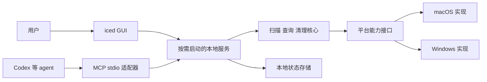

# ohMyDisk 功能范围与 MCP 设计

日期：2026-10-28

本文记录 ohMyDisk 首版的产品范围、GUI 与 MCP 的对应关系、清理授权约定和验收条件。该设计已确认并实施；实际覆盖范围与原生 CI 结果见 ../../verification-2026-10-28.md。

## 已确认的产品约束

- 使用 Rust、iced 和 Rust 生态能力实现。
- 首版支持 macOS 与 Windows，通过平台适配层保留新增平台的能力。
- 核心流程参考用户提供的 DaisyDisk 录屏：扫描、空间分析、逐层浏览、收集待清理项目、执行清理。
- MCP 覆盖完整流程，Codex 等 AI agent 能够在 GUI 未打开时扫描、查询、制订计划和执行已授权的清理。
- 默认移入系统废纸篓或回收站，同时提供单独授权的永久删除。
- MCP 清理信任 agent 宿主完成人工确认，ohMyDisk 不增加第二次弹窗或终端确认。

## 首版功能范围

| 模块 | 首版功能 | 对应的 agent 能力 |
|---|---|---|
| 磁盘与扫描对象 | 展示本地磁盘、名称、总容量和可用容量；选择文件夹；列出已保存的扫描结果；关闭结果条目 | 枚举磁盘、列出扫描、读取快照摘要、释放扫描结果 |
| 扫描任务 | 递归统计文件与目录；包含隐藏项目；显示扫描状态；取消和重新扫描；记录无法访问的位置 | 启动扫描、查询作业进度、请求取消、取得结果快照 |
| 空间分析 | 目录汇总、按大小排序、文件级大小、较小项目聚合 | 分页读取子项；按名称、类型、大小和修改时间查询；查找指定范围内的大文件或目录 |
| 可视化浏览 | 旭日图、列表联动、悬停详情、目录下钻、面包屑、前进与后退 | 按节点 ID 浏览树和读取详情，通过系统文件管理器定位；没有图形会话时返回明确状态 |
| 清理收集区 | 加入文件或目录、移出项目、清空集合、查看路径与合计大小 | 将选中的节点生成清理计划，读取计划明细；修改选择后创建新计划 |
| 清理执行 | 默认回收站、单独的永久删除入口、执行进度、逐项成功或失败结果、请求停止、清理后刷新 | 分别调用回收站与永久删除工具，查询执行作业和逐项结果 |
| 系统集成 | 原生目录选择器；在 Finder 或资源管理器中定位；展示平台能力与权限缺口 | 查询当前平台实际支持的大小统计、回收站和定位能力 |
| 本地状态 | 保存扫描摘要、快照和清理作业记录；GUI 与 agent 使用相同的状态 | 重连后可按 ID 查询；明确释放结果；后台作业不依赖 GUI 窗口 |

录屏仅演示了单个目录进入收集区。本范围补充多项目收集、移出、清空、执行结果和错误处理，使清理流程完整。文件查询和结构化计划用于让 agent 消费同一份分析结果。

首版不包含云存储、自动垃圾识别规则、重复文件内容检测、定时自动清理、远程公开 MCP 服务、文件内容预览，以及应用内置大模型。星标、扫描历史对比、图表导出和 MCP resources/prompts 放在后续。AI 分析由外部 agent 完成，应用不要求模型 API key。

## 界面与用户流程

首页展示磁盘与扫描对象。扫描对象显示未扫描、扫描中、可查看、结果不完整或失败等状态；关闭条目只移除结果，不删除源文件。存在被未过期且未执行的计划或活跃作业引用的快照时，应拒绝释放并返回引用信息。计划过期或执行终止后，保留独立清单与结果记录即可释放原快照。

分析页沿用录屏的布局关系：顶部路径导航，中部旭日图与按大小排列的子项列表，底部清理收集区。鼠标悬停只改变强调和详情，进入目录才改变当前浏览位置。较小项目的聚合只是展示节点，能够继续查询其成员，不可直接作为删除目标。

收集项目后，原始扫描快照和总量保持不变。界面分别显示原始占用、已选清理大小和未选部分；图表可以标记或过滤已收集项目，标签必须说明当前口径。移入回收站成功不等于空间已经释放，结果页另行查询磁盘可用容量。

清理结束后，服务将受影响扫描标记为 known_stale，并对相同扫描根排队发起新扫描。旧快照内容保持不变，查询时附带过时标记和刷新作业引用；新扫描完成后 GUI 切换到新快照，MCP 清理结果返回 refresh_job_id 与新 scan_id。刷新失败时保留旧结果与明确提示，不能将旧节点扣除后继续沿用同一个快照版本。普通扫描结果也始终注明采集时间，不承诺实时反映外部进程的修改。

GUI 执行清理时由 GUI 确认；MCP 执行时由宿主确认。确认界面应能获得服务端生成的完整计划，展示目标、操作方式和风险。永久删除使用单独入口。

## 扫描与统计语义

- 扫描根必须为明确的本地绝对路径，受当前用户的操作系统权限及应用范围配置约束。不自动提权。
- 默认不跟随目录符号链接、Windows junction 和未知 reparse point，不跨文件系统继续递归；记录这些边界。显式扫描另一个卷应启动独立扫描。
- 遇到拒绝访问、文件消失等错误继续处理其他项目，返回错误计数、可分页查询的明细和结果完整性。不可访问目录不能记为已知的零字节。
- 默认展示逻辑大小；分配大小在平台可获取时提供，未知值使用 null。API 与界面都说明统计口径。
- 路径树可包含硬链接的每条路径；涉及物理占用的汇总需要文件身份去重。APFS clone、快照、稀疏文件等情况使占用统计不能直接等同于可释放容量，不提供无法验证的精确释放承诺。
- 进度包含已发现文件数、目录数、已统计字节、耗时和阶段。未知总工作量时不展示伪精确百分比。
- 扫描过程中可向 GUI 发送批量进度与预览；稳定分页查询和清理计划使用完成后冻结的快照。取消后的部分结果保留完整性标记，不作为完整目录的删除依据。
- 停止请求采用协作式取消。已经进行的单次系统调用可能先完成，界面和 MCP 应区分 cancel_requested 与最终 cancelled。

## 建议的进程与模块边界

| 方案 | 优点 | 代价与限制 |
|---|---|---|
| MCP 运行在 GUI 进程内 | 初始进程结构简单 | GUI 退出会影响 agent，不满足独立使用要求 |
| GUI 与 MCP 各自持有独立引擎实例 | 两个入口可以独立开发 | 活跃作业、取消、清理计划和执行状态容易产生多份所有权 |
| 按需启动的单一本地服务，加 GUI 与 stdio 适配器 | 两个入口共享快照和任务，支持多个客户端与无 GUI 工作 | 需要本地 IPC、实例启动协调和异常恢复；建议采用 |

建议一个发布物提供 gui、mcp 和内部 service 模式，不安装开机自启的系统服务。GUI 或 MCP 首次连接时启动当前用户的服务；没有连接和活跃作业后退出。MCP 适配器退出只关闭该协议连接，不取消已经受理的后台作业。服务必须独立于 stdio 适配器的退出与进程树清理；Windows 需验证宿主 Job Object 对子进程的限制，无法独立启动时明确报错，不承诺后台继续运行。



建议按以下职责组织 Cargo workspace，实现计划可以合并较薄的模块，但依赖方向保持清楚。

| 模块 | 职责 |
|---|---|
| ohmydisk-core | 扫描与查询用例、节点和快照模型、清理计划、执行状态；定义平台与存储接口，不依赖 iced 或 MCP |
| ohmydisk-platform | macOS 与 Windows 的磁盘、文件身份、大小、回收站和文件管理器实现；报告能力差异 |
| ohmydisk-service | 核心组合、后台作业管理、本地存储、IPC、单实例协调和执行并发控制 |
| ohmydisk-gui | iced 界面、旭日图、列表、路径导航和收集区；消费服务状态 |
| ohmydisk-mcp | MCP schema、工具处理、结果映射和 stdio 生命周期；消费同一服务 |

macOS 使用用户私有目录中的 Unix domain socket；Windows 使用限制当前用户的 named pipe。连接包含应用协议版本校验。多个入口同时启动时只产生一个当前用户服务，失败的竞争者连接已存在的实例。持久化选择 SQLite，由服务协调写入；采用单服务的原因是统一内存作业和执行所有权。

后台扫描使用受限并发的阻塞 worker，向服务和 GUI 分批发送事件，避免目录遍历阻塞 UI 或协议执行器。查询只读冻结快照；写入和清理任务由服务串行协调相交目标。不同入口不得同时执行涉及同一目标的两份清理计划。

## MCP 连接与兼容性

首版提供本地 stdio，使用 Rust 官方生态的 rmcp 评估实现。SDK 版本与工具链在握手验证后锁定，不因为存在最新 SDK 就假定所有目标客户端兼容。协议实现需通过当前 Codex 与独立 MCP 测试客户端的验证。

Codex 支持本地 stdio 和 Streamable HTTP，并用 config.toml 管理服务；本产品选择 stdio 作为首版入口。[OpenAI 官方 MCP 接入文档](https://learn.chatgpt.com/docs/extend/mcp)

标准输出只写 MCP 消息，诊断日志写标准错误。扫描和清理采用 ohMyDisk 自己的 job_id 协议：启动调用迅速返回句柄，后续轮询状态和读取结果。取消查询请求不代表取消后台作业，停止后台作业必须使用显式工具。

返回使用 JSON Schema 定义的对象，提供 structuredContent 与序列化 JSON 文本回退。可选进度通知只作增强，不依赖 MCP Tasks 扩展或客户端通知支持才能完成工作。分页 cursor 由应用定义，绑定快照版本、查询条件和排序，避免排序漂移。[MCP 工具及结构化结果规范](https://modelcontextprotocol.io/specification/2025-11-25/server/tools)、[stdio 规范](https://modelcontextprotocol.io/specification/2026-07-28/basic/transports/stdio)

## MCP 首版工具契约

工具名采用 omd_ 前缀，以下名称为建议的公开契约。节点查询、扫描列表、问题明细和清理明细默认返回 100 项，最多 500 项，返回 next_cursor；结果不一次性倾倒整棵目录树。

| 工具 | 主要输入 | 主要输出与行为 |
|---|---|---|
| omd_get_capabilities | 无 | API 版本、平台、大小统计能力、支持的清理方式、范围策略和授权模型 |
| omd_list_sources | 无 | 磁盘信息、可用容量、可扫描状态及平台权限说明 |
| omd_start_scan | root_path、扫描策略、request_key | scan_id、job_id；受理后返回，不等待整盘扫描完成；同一请求键不重复启动 |
| omd_list_scans | cursor、limit | 已保存快照与扫描作业的摘要和状态 |
| omd_get_scan | scan_id | 快照根、统计口径、完整性、时间与错误摘要；未完成时返回作业引用 |
| omd_list_scan_issues | scan_id、cursor、limit | 无法访问、文件消失、链接和跨卷边界等逐项问题，以及受影响节点 |
| omd_get_job | job_id | 阶段、状态、计数、耗时、结果引用、错误计数及建议的下一次查询间隔 |
| omd_cancel_job | job_id | 接受停止请求或返回已终止状态；不承诺回滚已完成的清理 |
| omd_list_children | scan_id、node_id、cursor、limit | 直接子节点、大小与完整性，按大小和节点 ID 稳定排序 |
| omd_query_nodes | scan_id、范围节点、名称或类型或大小或修改时间过滤、cursor、limit | 匹配的真实节点；显式区分直接子项与全部后代，标注父子关系，避免将目录与后代大小再次求和 |
| omd_create_cleanup_plan | scan_id、node_ids、mode、request_key | 立即返回 plan_id 与准备作业 job_id；后台规范化目标并生成清单，完成后得到不可变计划；只制订计划，不删除 |
| omd_get_cleanup_plan | plan_id、cursor、limit | 准备中时返回作业引用；完成后返回 plan_hash、摘要、清单分页、操作方式、有效期与执行状态，供宿主展示与审批 |
| omd_execute_trash | plan_id、plan_hash、request_key | 只接受 trash 计划，创建或返回同一清理 job_id，不能隐式改为永久删除 |
| omd_execute_permanent | plan_id、plan_hash、request_key | 只接受 permanent 计划；独立工具描述和宿主审批，不能复用回收站操作的授权 |
| omd_get_cleanup_result | job_id、cursor、limit | 逐项成功、失败、跳过、未开始或结果未知，以及容量前后观测和刷新作业引用 |
| omd_release_scan | scan_id | 释放未被有效计划或活跃作业引用的结果；与删除源文件明确区分 |
| omd_reveal_node | scan_id、node_id | 通过系统文件管理器定位；没有图形会话或能力不支持时返回结构化错误 |

get_capabilities、查询与读取结果类工具标为只读。start_scan、创建计划、取消作业和释放快照会改变应用状态，但不清理用户文件。两个 execute 工具明确标为破坏性操作；annotations 仅用于宿主理解工具，不承担实际授权验证。

GUI 的图形浏览状态和拖放动作无需逐一暴露为 MCP 工具。agent 使用节点查询和计划接口完成同样的任务；首版不要求 agent 操作图表，也不要求把自然语言清理建议当作应用内置规则。

## Agent 的典型调用流程

```text
get_capabilities / list_sources
  → start_scan
  → get_job，直到扫描完成
  → get_scan / list_children / query_nodes
  → 向用户解释占用与候选项目
  → create_cleanup_plan
  → get_job，直到计划准备完成
  → get_cleanup_plan，向用户展示目标与方式
  → 宿主获得用户对该计划和方式的明确批准
  → execute_trash 或 execute_permanent
  → get_job / get_cleanup_result
  → 报告逐项结果与实际观测到的空间变化
```

工具描述和初始化说明要求 agent 在执行前展示服务端计划，不能自行增加“可以安全删除”的保证。永久删除的批准必须明确包含 permanent 方式。自动垃圾判断与无人值守预授权不属于首版功能。

## 清理计划与授权语义

MCP 采用用户选择的 host_confirmed 模型。宿主负责在分发执行调用前获得用户批准；ohMyDisk 将执行调用视为可信宿主转达的授权，不额外弹窗。不提供 confirmed=true 或 approve 工具来声称独立验证了真人批准。

宿主应对 execute_trash 和 execute_permanent 分别配置人工审批。MCP 本身无法让服务端通用地验证宿主是否弹出确认，所以 host_confirmed 是部署信任约定；兼容客户端必须在接入测试中验证其审批配置。文件名和元数据是数据，不能改变工具授权或生成 shell 指令。应用不执行由 agent 提供的脚本。

计划必须由服务端从快照节点生成，绑定 scan_id、快照版本、节点与文件身份、递归目录成员清单、操作方式及有效期。建议从计划准备完成时起有效 10 分钟，使用服务端时间。准备作业的输入节点数设上限 500；更大的选择通过父目录节点表达，不能以参数塞入整棵树。计划修改后产生新的 plan_id 和 hash，要求重新向用户展示并批准。

计划规范化会去除重复目标和已由父目录覆盖的子目标；聚合显示节点不可执行。拒绝文件系统根、卷根、用户主目录本身、操作系统关键目录与 ohMyDisk 自身状态目录。路径字符串不是执行权限，清理工具只能执行计划中的目标，不能附带任意新路径。

执行前复核路径、文件身份、链接类型和目录成员。文件已替换、目录新增成员、成员变化或扫描不完整时，返回 stale_plan、跳过变化目标，并要求重新扫描或生成计划。复核降低竞态风险，不能声称跨平台原子冻结了正在被其他进程修改的目录。

系统回收站以目录为单位处理时，首版不得在检测到变化后继续整体处理该目录。永久删除按已授权清单自下而上处理，不允许无差别递归吞入新增文件；目录非空时保留并报告。执行期间仍存在跨平台文件系统竞态，能力与测试应明确这一实际边界。

同一计划最多关联一个执行作业。服务端在数据库事务内认领计划并登记作业；这一原子性不包含文件系统操作。request_key 按当前本地用户与工具名划定作用域，并记录规范化输入摘要。相同键且相同输入返回已有作业；相同键但参数不同返回 request_conflict。首版的请求去重记录随作业与计划元数据保留，不自动过期，释放扫描快照不删除这些记录；用户清除应用数据后不再承诺历史请求去重。

重复提交已经执行的计划先返回其原作业；只有尚未受理的执行需要检查计划有效期。不能因原计划到期而无法查询已受理的作业。取消只停止尚未开始的项目，失败或取消不会自动恢复已经成功的项目。

清理记录保存计划 hash、请求来源、host_confirmed 授权模型、执行方式、时间、逐项结果和空间观测。clientInfo.name 只作排障信息，不作为可信身份或真人授权证据。

## 数据与状态约定

| 对象 | 必要字段与不变量 |
|---|---|
| Scan | scan_id、job_id、根路径、扫描策略、状态、最终 snapshot_id；重新扫描生成新的 scan_id 与快照 |
| Snapshot | snapshot_id、版本、冻结时间、完整性、统计口径、错误计数；完成后不可变 |
| Node | node_id、父 ID、类型、显示名称、可显示路径、逻辑字节、可选分配字节、修改时间、完整性、平台文件身份 |
| CleanupPlan | plan_id、hash、snapshot_id、mode、规范化目标与递归成员、合计大小、有效期；目标或方式改变必须生成新计划 |
| Job | job_id、kind、状态、阶段、进度、错误、结果引用、request_key；运行中的作业由服务持有 |
| CleanupResult | 逐项结果、执行方式、错误码、观测前后容量、刷新作业引用；不把计划大小直接当作已释放字节 |

作业状态包括 queued、running、cancel_requested、completed、completed_with_errors、cancelled、failed、interrupted。是否完整另用 completeness 表达，不能让 completed_with_errors 自动意味着任何目录都可以完整清理。数据中的容量统一使用字节，时间使用带时区的标准格式，路径显示与操作系统原生路径分开存储，避免有损字符转换成为执行路径。

业务失败以 MCP isError 及稳定的结构化错误码返回。至少覆盖 permission_denied、path_not_allowed、not_found、unsupported、scan_not_ready、incomplete_subtree、invalid_cursor、stale_plan、plan_expired、mode_mismatch、plan_in_use、request_conflict 和 service_unavailable。批量清理的部分失败属于作业结果，不伪装成整批成功。

每个清理系统调用前先持久化该项 started 状态，完成后再记录结果。服务异常重启后，未完成作业标为 interrupted；保留可查询记录。已 started 但没有最终记录的项标记 in_doubt，表示系统操作可能已经生效，不能判断为失败或未开始。首版不自动续跑清理，也不重放这些状态不明的调用；重试先返回已有作业与未知结果，需要重新检查文件系统后制订新计划。

## Codex 接入示例

以下是应用实现并安装后的配置形式，当前命令尚未提供；本设计不修改用户现有的 Codex 配置。

```toml
[mcp_servers.omd]
command = "/absolute/path/to/ohmydisk"
args = ["mcp", "--stdio"]
```

Windows 的 command 使用实际安装的 ohmydisk.exe 绝对路径。对应的 CLI 注册形式为 codex mcp add omd -- 后接实际可执行文件与 mcp --stdio 参数。接入时必须在宿主中分别验证回收站与永久删除工具的人工审批行为；应用不能代替宿主修改其全局批准策略。

## 验收条件

- macOS 与 Windows 上分别完成选择目录、扫描、浏览、收集、回收站清理及永久删除的端到端验证。平台不支持的能力返回明确结果，不能静默降级。
- GUI 与 MCP 查询同一快照时，节点、统计口径和完整性一致。agent 创建的计划在 GUI 中可读，GUI 生成的计划也能由 MCP 查询。
- GUI 未启动时，标准 MCP 客户端能够完成扫描、分页查询、在宿主批准后清理及读取结果。
- 大目录扫描期间 GUI 仍可交互，任务查询能及时响应，取消能进入终态。用固定文件集和真实目录记录耗时、峰值内存和 UI 响应，性能目标在实现计划中依据基线制定。
- 权限错误、隐藏文件、符号链接、硬链接、稀疏文件、Windows junction、长路径、特殊字符和非标准路径编码有明确行为与适用平台测试。
- 查询分页在同一快照上无重复或遗漏；目录与后代不能被 agent 不知情地重复汇总。
- 收集操作不改动源文件。回收站清理与永久删除不能共享或隐式切换操作方式；不能因不支持回收站而改为永久删除。
- 目标替换、目录新增成员、计划过期、父子重叠、重复执行、取消和部分失败都有实际测试。测试只使用隔离的临时目录与文件。
- 服务及 stdio 适配器断开、重连、响应丢失和异常重启不会产生重复清理或静默续跑。
- Codex 接入不仅通过工具发现，还需实际完成启动、查询、批准回收站清理、单独批准永久删除及结果读取。

## 实现顺序建议

先实现扫描、节点模型、平台接口和作业状态，再建立本地服务及 MCP 只读流程。随后完成不可变清理计划、两种执行方式和重复请求处理，用同一服务支撑 GUI 的空间分析与收集区。交付前补齐两平台集成测试、MCP 客户端接入验证和安装包。

参考资料包括用户录屏约 09–52 秒展示的目录扫描、旭日图浏览与收集流程，以及 [rmcp 官方发布](https://github.com/modelcontextprotocol/rust-sdk/releases/tag/rmcp-v3.8.0)。协议与 SDK 版本会变化，依赖锁定和客户端兼容验证属于实现工作。
