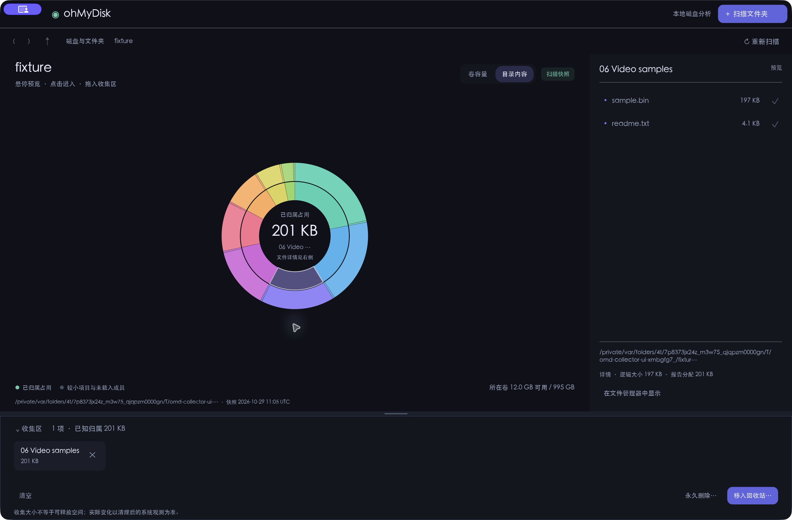
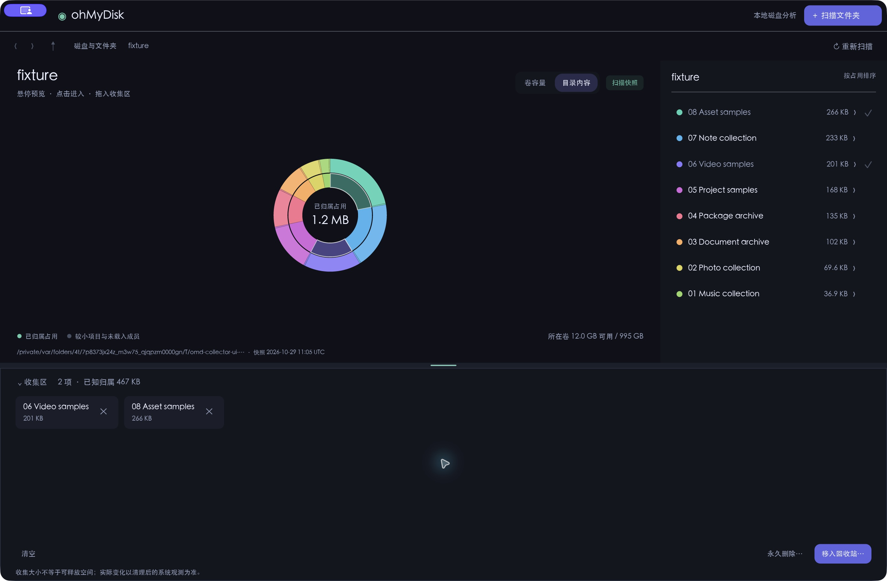
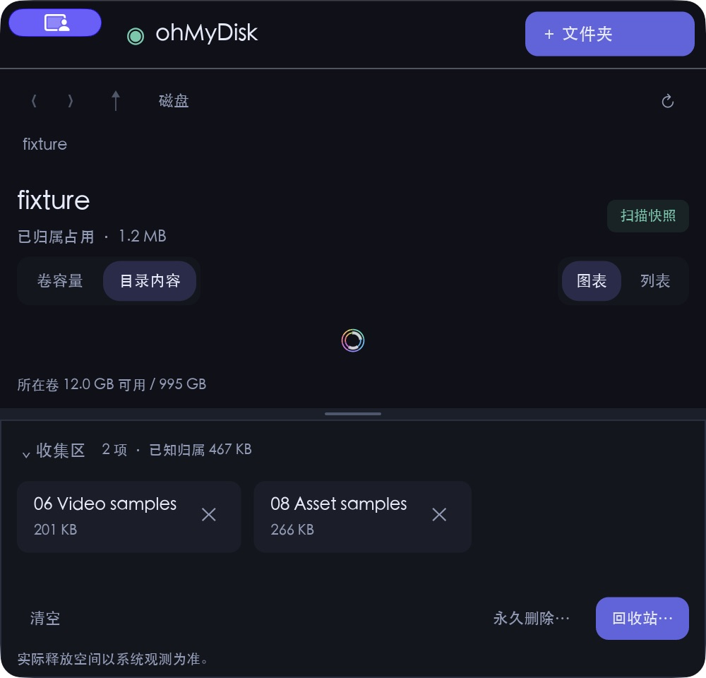

# Collector interaction acceptance — 2026-10-29

The two requested behaviors passed native macOS acceptance: dragging a real
chart/list item into the collector, and dragging the separator to grow or shrink
the collector. The minimum-size chart has a layout limitation described below.

## Versions and scope

- Product code: `2c6de26e377814a5f5910dac7924ad329104b166`.
- Widget regression tests: `f4a899beda8dc95dd431319521cc4e69157d47b3`.
- Native observation used a local release build, with SHA256
  `dc7552ee535ad5babbc34ff2044fff4b313626c802068ad6bc11cf6b39fb0129`.
  The isolated test app's executable text matched the source executable after
  changing its bundle identity and signing the temporary app.
- The fixture contained eight directories and 16 generated files. It used a
  fresh service database and an app identity separate from the installed app.
- All heights below are logical pixels. The observed display scale was 2.
- This is application-internal drag/drop. Finder/Explorer imports are outside
  this change. Windows received native CI coverage, but its GUI gestures were
  not manually exercised.

## Observed native behavior

| Operation | Result |
|---|---|
| Direct drag from `06 Video samples` chart sector, without a preceding source hover | Collector changed from 0 to 1 item and expanded. The fixture root remained current; only the preview changed. |
| Direct drag from `08 Asset samples` list row, without a preceding source hover | Collector changed from 1 to 2 items. No directory navigation occurred. |
| Drag separator upward | Collector height changed from 180 to 330; content layout moved with the boundary. |
| Drag separator downward | Collector height changed from 330 to 230; this remained a resize session and did not submit a drop. |
| Drag `07 Note collection` and release in content space | Collector remained at 2 items. Trace recorded `inside=false` and `drop=false`. |
| Collapse, then expand | Display height changed to 64, then restored the chosen 230 height. |
| Resize window to 500×480 | Navigation, metric summary, chart/list switch, collected cards and collector actions remained within the window. Chart usability is limited as described below. |

Ordered input traces confirmed one accepted drop for each chart/list gesture.
They also captured a separator press whose final frame cursor was already at a
later position; the ordered press coordinate still hit the divider correctly.

## Minimum-size limitation

At 500×480 with an expanded collector, the fixed content controls leave an
approximately 16-pixel sunburst. This verifies control reachability, not usable
chart detail at that size. Collapsing the collector or switching to the list
provides the available browsing controls. A further compact-height layout
improvement remains possible; no such redesign is included in this change.

After the core checks, the automation tool reported a foreground-app change.
Further input stopped. A subsequent read-only observation showed four cards in
two rows at 500×900, but the two extra selections were not attributed to the
automated test. That observation supports wrapping only.

## Automated checks and distribution

- Local workspace validation passed 174 Rust tests and 11 Python tests.
  Formatting passed. Clippy completed with lint warnings.
- Three tests drive actual Sunburst Canvas, Scrollable/Source and divider widget
  trees with the CPU renderer. They cover a stale frame cursor, captured release,
  one drop without navigation, and the expected height message.
- Reintroducing the stale child cursor caused the Scrollable combination test
  to fail. Restoring the committed implementation passed all 19 interaction
  module tests, with a clean source diff afterward.
- All three native platform jobs passed for product code in
  [run 40862955428](https://github.com/looading/ohMyDisk/actions/runs/40862955428)
  and for the additional widget tests in
  [run 40864379398](https://github.com/looading/ohMyDisk/actions/runs/40864379398).
  Jobs cover workspace checks, historical benchmark smoke, isolated MCP/native
  recycle-bin workflows and packaging.
- The three product ZIPs from the first run passed SHA256, archive integrity,
  required-document, architecture, version and company-marker checks. Both
  macOS bundles passed strict signature integrity verification. Their signatures
  are ad hoc; no Developer ID or notarization result is claimed.

## Fixture integrity

The final read-only database inspection found zero execution rows, no cleanup
plan, one scan and one job. All 16 fixture file hashes matched the pre-acceptance
inventory. The collector gestures neither prepared nor executed cleanup.

The complete local record is retained in
`/tmp/omd-collector-ui/ordered-native-acceptance.json`, with 11 screenshots, a
trace copy and the final read-only audit. Public evidence above contains only
the generated fixture window; no user-data scan is shown.
