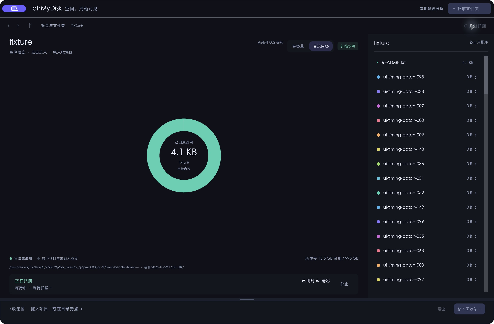
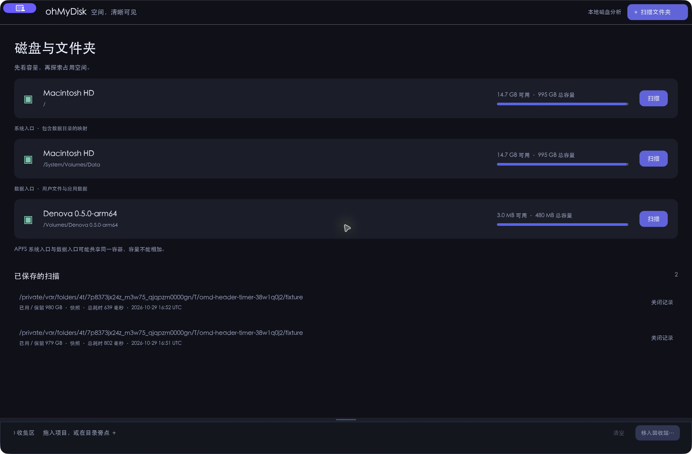

# Header alignment and scan duration — 2026-10-30

## Resulting behavior

- The native window title and visible header read `ohMyDisk 空间，清晰可见`.
  The decorative circle and middle-dot separator were removed.
- The original Mac close/minimize/zoom buttons remain native. Their shared
  titlebar container is resized with its top anchored so the group aligns to
  the 48-point application header's center. On the test Mac this changes the
  container from 32 to 40 points while preserving the buttons' original y9
  position, 14-point size and target/actions. The user confirmed this version
  was visually aligned.
- Running jobs display elapsed time separately from progress text. The existing
  650ms active-job subscription redraws a local monotonic clock even while a
  progress RPC is pending. The active scan's history row uses the same clock;
  idle windows gain no periodic scan timer.
- Scan jobs persist `elapsed_ms` and `finished_at` on success, cancellation or
  failure. The measured duration includes queueing, traversal, saving, indexing
  and publication. Scan details/history expose the frozen value after completion
  and reopening. Legacy records without a trustworthy measurement display
  `总耗时未记录`; snapshot creation time is not used to invent a total.

The titlebar implementation follows the native-container approach used by
[tao](https://github.com/tauri-apps/tao/blob/39d130f9bd604bea1b183581b5fb47939a193a40/src/platform_impl/macos/view.rs#L1017-L1046).
It validates the shared button view and ancestors before touching the container,
uses synchronous main-thread callbacks, and stores only a per-view `Cell<bool>`
reentrancy flag. No button reparenting, delegate replacement, class swizzling,
private selector or global native window handle is involved. Fullscreen layout
is left to AppKit; native layout/resize/draw callbacks reapply ordinary alignment.

## Local checks

- 181 Rust tests and 15 Python tests passed; formatting, Clippy (with lint
  warnings), release build, isolated release MCP smoke and native Mac package /
  strict signature checks passed.
- Service tests hold metadata with unchanged progress, verify elapsed time
  advances, and check frozen completed/cancelled/failed totals through Job,
  scan detail, history and Engine restart.
- GUI tests verify advancement without new progress, stale samples not rewinding
  time, legacy unknown totals, sub-second/long duration formatting and saved
  summary decoding. Native geometry tests cover top anchoring, flipped parents,
  repeated alignment and invalid dimensions.
- Independent review found no blocking lifetime, reentrancy, coordinate or
  terminal-persistence issue.

The final local executable SHA256 is
`3f440fe851ba5509ba7c8d43bfa877d587161ff992e52dbfc019e450012d6d8e`.
The user-observed container test used a local build with the same final native
container source (`b6cce47e142e57911302e1cfe62ac578036293c711a1ba9db09a18c5a112cc07`).
The later view-only change preserves elapsed display for non-scan active jobs.

## Native observations

The controlled fixture contained 160,000 empty files and one README. These are
short functional tests, not a real-world scanning-performance benchmark.

| Check | Observation |
|---|---|
| Header/system title | Product name followed by the existing slogan, without the decorative circle or middle dot |
| Live display | A native frame showed `正在扫描` and `已用时65毫秒` |
| Completed totals | Two fixture scans recorded 802ms and 639ms |
| History/detail reopen | History retained both exact values after GUI reopen; reopening the second detail still showed 639ms |
| Final native container | Trace recorded top-anchored 32→40-point container, original button y9, group center 24 points from content top |
| User visual acceptance | The first child-frame-only attempt was rejected as still high; the container version received `这次已对齐` |

The fixture scan finished before multiple 650ms ticks, so these native images
are not claimed to demonstrate repeated visual increments during a long scan.
The no-progress/pending-response clock behavior is covered by tests. System
window-sharing UI obscures the caption controls in automated screenshots; the
final visible-alignment acceptance is the user's observation, supported by
native geometry, rather than a claimed independent pixel measurement.

## Evidence exclusions and correction

A picker exercise initially selected the default directory rather than the
intended fixture. That read-only scan was stopped; its temporary state index,
runtime log and screenshots were removed. The discarded run had zero execution
rows, no plan and only a scan-start request; no source-file cleanup was executed.
It contributes no acceptance evidence. Subsequent accepted timer observations
used the exact fixture path through CLI and GUI reopening. Their frozen audit
had zero executions, no plans and two fixture scans. Later unrelated scan
records in the shared temporary profile are excluded from these observations.

Detailed local records remain under `/tmp/omd-header-timer`: the frozen native
acceptance, before/after reopen summaries, final manual confirmation, container
trace and correction audit. Public images above show the generated fixture only.

The separate scan-reliability checkout's uncommitted engine/store/tests were not
overwritten or staged. These changes were built and tested in the isolated
worktree. A read-only three-way check confirmed the timing patch can merge with
that separate work; it is not presented as integration or verification of it.

## Native CI and downloadable builds

Product commit `584440d63798ed7c74e2b823aa30c44c375cdb41` passed
[run 40921660418](https://github.com/looading/ohMyDisk/actions/runs/40921660418).
Both Mac architectures passed 181 Rust tests; Windows passed 161 platform-specific
Rust tests. All three passed 15 Python tests, formatting, Clippy, release build,
benchmark correctness/history smoke, MCP/native recycle-bin smoke and native
package/icon validation before ZIP + SHA256 upload.

- [macOS Apple Silicon](https://github.com/looading/ohMyDisk/actions/runs/40921660418/artifacts/12917904598)
- [macOS Intel](https://github.com/looading/ohMyDisk/actions/runs/40921660418/artifacts/12919520810)
- [Windows x64](https://github.com/looading/ohMyDisk/actions/runs/40921660418/artifacts/12917929506)

These are the uploaded CI packages. No additional download-side archive checks
are claimed. The acceptance documentation commit changes only documentation and
fixture screenshots; the tested product Rust code remains `584440d`.
